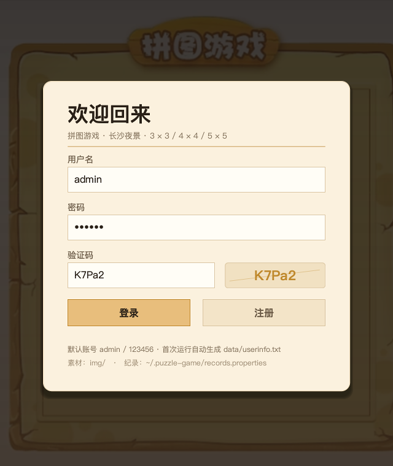
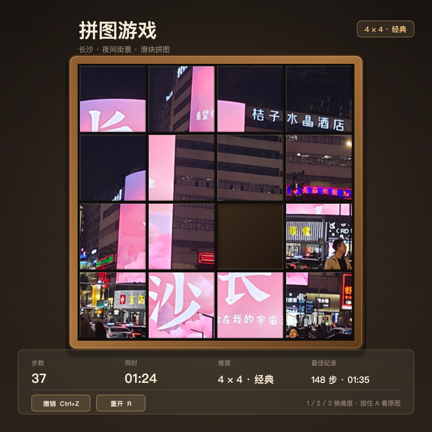
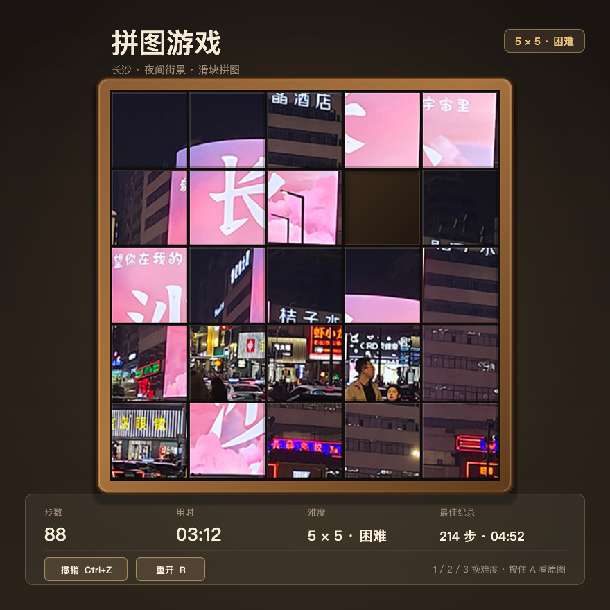
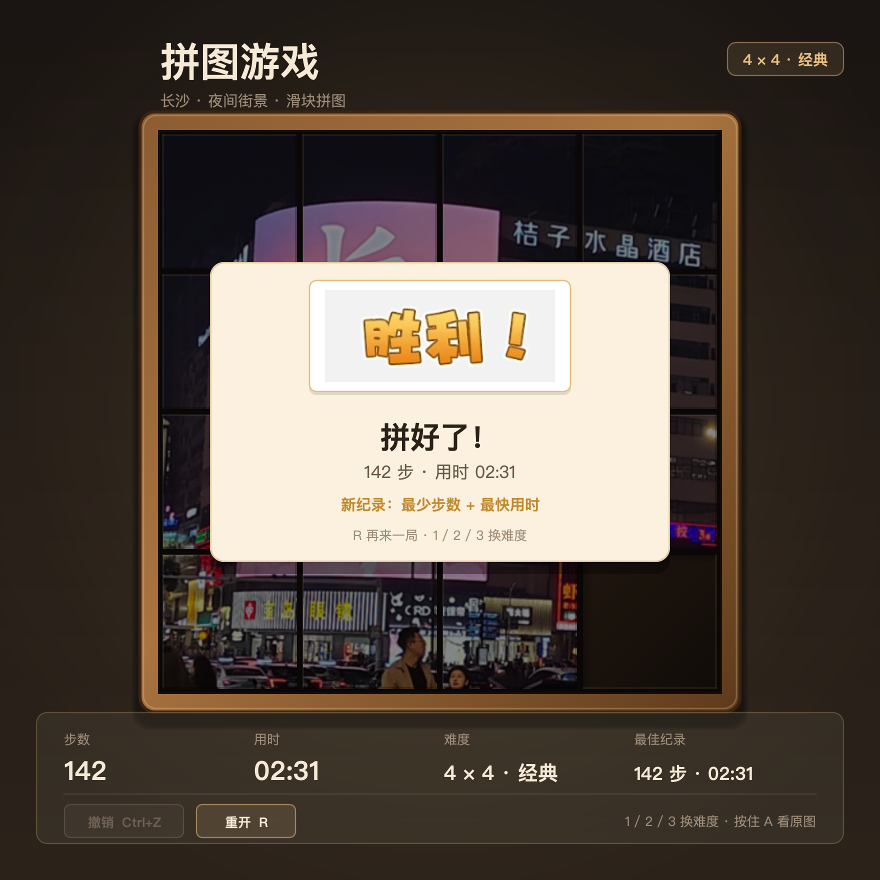
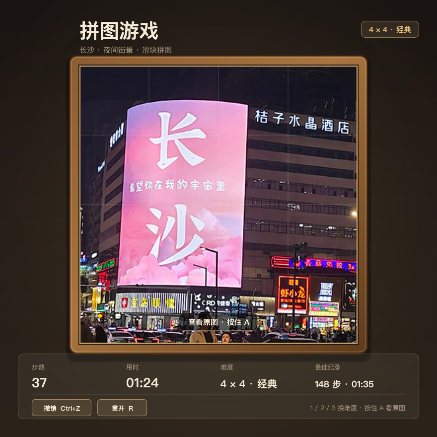
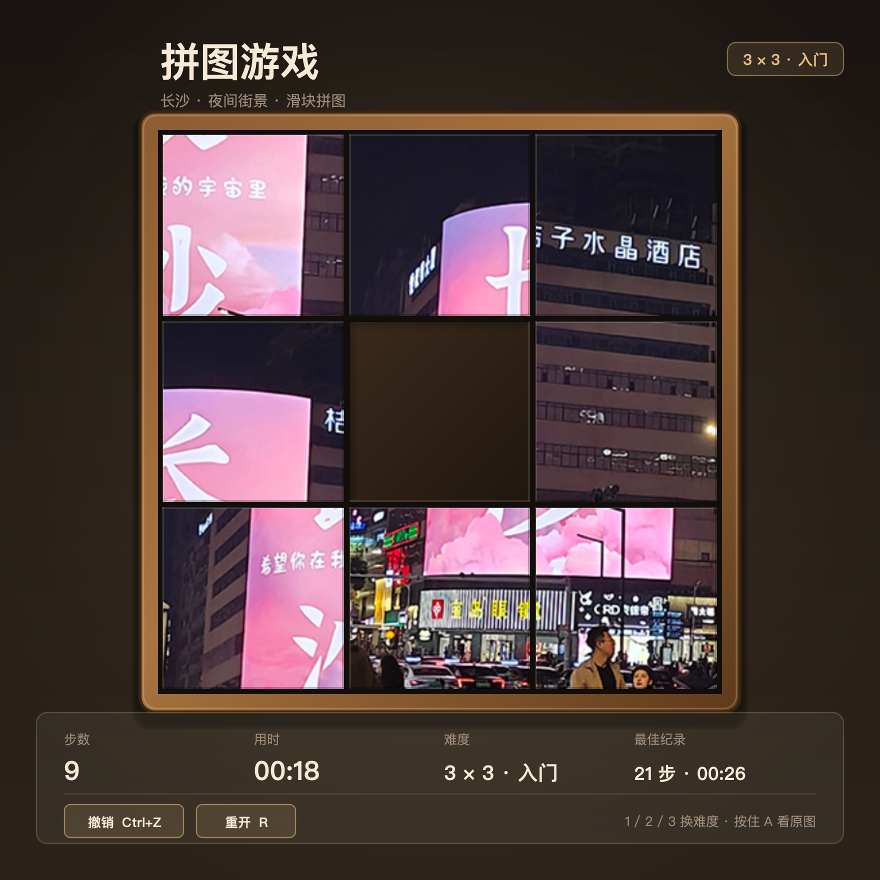

# puzzle-game

> Java Swing 拼图小游戏：3×3 / 4×4 / 5×5 三档滑块拼图，带注册登录、验证码、计时、最佳纪录、撤销和查看原图

## 界面预览

<table>
  <tr>
    <td align="center"><br/><sub>登录页（背景是 <code>img/bg.png</code> 压暗后的木质纹理）</sub></td>
    <td align="center"><br/><sub>4×4 进行中：步数 37 / 用时 01:24 / 最佳 148 步</sub></td>
  </tr>
  <tr>
    <td align="center"><br/><sub>5×5 进行中：素材由 <code>all.png</code> 现切 25 块</sub></td>
    <td align="center"><br/><sub>拼好了：胜利标志 + 步数 + 用时 + 新纪录</sub></td>
  </tr>
  <tr>
    <td align="center"><br/><sub>按住 <code>A</code> 查看原图（叠加层，松开消失）</sub></td>
    <td align="center"><br/><sub>3×3 入门：格子明显更大，同一条状态栏</sub></td>
  </tr>
</table>

上面 6 张图不是手画的示意图，也不是截屏拼接：它们是 `tools/Snapshot.java` 把**真实界面用的那个面板**（`GamePanel` → `BoardRenderer`）
离屏渲染成 PNG 得到的（2 倍超采样再缩回，所以文字边缘干净）。同一套绘制代码既服务窗口也服务截图，改界面时截图不会漂移，重新跑一次即可：

```bash
javac -encoding UTF-8 -d /tmp/pg $(find src tools -name '*.java')
java -cp /tmp/pg Snapshot          # 输出 docs/01-login.png ... docs/06-game-3x3.png
```

## 项目简介

一个用 Java Swing 手写的桌面拼图游戏：先注册 / 登录（带验证码），再进游戏。玩法是经典**数字华容道（滑块拼图）**——
一张长沙夜景照片被切成 N×N 块打乱（其中一块是空位），用方向键或鼠标把滑块推来推去，直到还原成原图。

现在是三档难度（3×3 / 4×4 / 5×5）：**从第一次移动开始计时**，每档难度分别记录「最少步数」和「最快用时」，
拼好后除了 `img/win.png` 的「胜利」还会显示步数、用时和是否破纪录；走错了可以 `Ctrl+Z` 撤销（保留最近 50 步）。

窗口不含图片素材以外的资源，没有音频、没有联网、没有第三方依赖：用户数据存在一个 txt 里（由 `UserStore` 统一管理路径），
最佳纪录存在 `~/.puzzle-game/records.properties`（`java.util.Properties`）。

## 功能

| 功能 | 说明 | 主要代码 |
| --- | --- | --- |
| **三档难度** | 3×3 入门 / 4×4 经典 / 5×5 困难，菜单「难度」或按 `1` `2` `3` 切换，切档即重新洗牌 | `Difficulty`、`GameJFrame.switchDifficulty` |
| **可解性校验** | 洗牌后用逆序数判据校验，奇数宽度和偶数宽度**判据不同**（见下文「可解性判据」），不可解重洗 | `Solvability`、`Board.shuffle` |
| **计时器** | 第一次移动才开始走，状态栏显示 `MM:SS`，胜利即停表 | `GameJFrame.startClock` / `finish` |
| **最佳纪录** | 按难度分别保存最少步数与最快用时到 `~/.puzzle-game/records.properties`，破纪录时胜利卡片会写「新纪录：最少步数 / 最快用时」 | `Records` |
| **撤销** | 保留最近 50 步，`Ctrl+Z` 或状态栏「撤销」按钮，**步数同步减回去** | `Board.undo`、`GameJFrame.undo` |
| **鼠标操作** | 点空格旁边的方块即可移动它；状态栏两个按钮也是鼠标点的 | `GameJFrame.handleClick`、`BoardRenderer.cellAt` |
| **查看原图** | 按住 `A` 叠一层 `img/all.png`，松开消失 | `BoardRenderer.drawOriginalOverlay` |
| **胜利提示** | `win.png` + 步数 + 用时 + 是否破纪录 + 「R 再来一局」提示 | `BoardRenderer.drawWinOverlay` |
| **统一状态栏** | 步数 / 用时 / 难度 / 最佳纪录 / 撤销 / 重开 / 换图提示，全在底部一条卡片里，拼图区上方不再挂零散标签 | `BoardRenderer.drawStatusBar` |
| **离屏截图** | `tools/Snapshot.java` 复用真实面板渲染 6 张 PNG | `tools/Snapshot.java` |

保留的旧功能：注册 / 登录 / 验证码流程、`UserStore` 公开方法、菜单「重新游戏 / 重新登录 / 关闭游戏 / 公众号」。

## 操作方式

| 操作 | 效果 |
| --- | --- |
| `←` `↑` `→` `↓` | 把空位朝这个方向挪一格（等价于把那个方块推进空位），越界不生效 |
| 鼠标点空格相邻的方块 | 同上，移动被点的那个方块 |
| 按住 `A` | 叠加显示完整原图，松开恢复 |
| `Ctrl+Z` / 状态栏「撤销」 | 撤销一步，步数同步 −1（最多回退 50 步） |
| `R` / 状态栏「重开」 | 同一难度重新洗牌，步数与计时清零 |
| `1` `2` `3` | 切到 3×3 / 4×4 / 5×5 |
| 菜单「功能 → 重新游戏 / 重新登录 / 关闭游戏」 | 重开一局 / 回登录窗口 / `System.exit(0)` |
| 菜单「关于我们 → 公众号」 | 模态 `JDialog` 显示 `img/wy.png`，标题 `about my girl` |
| `W` | **一键通关**（调试后门，代码里带 `// TODO: 发布前删除调试后门`；不结算纪录） |

## 玩法与计分

- **开局**：`Board.shuffle()` 把 `0..n²-1` 用标准 Fisher–Yates 打乱，再用 `Solvability` 校验可解性，不可解就重洗；
  值为 `0` 的那格是空位，`Board` 内部同步记着它的行列号。
- **移动**：`Board.move(direction)` 交换空位与相邻格，成功才 `steps++`，并把方向压进撤销栈（超过 50 步丢最旧的）。
  所以方向键的语义是「把空格往这个方向挪」，和大部分滑块拼图的手感一致。
- **计时**：第一次成功移动时 `startedAt = System.currentTimeMillis()`，之后 `Timer` 每 200 ms 刷新状态栏；
  胜利时把用时冻结在 `frozenMillis`，撤销不会让表倒流。
- **计分**：只有 `steps` 一项硬指标。撤销会把 `steps` 减回去，所以「刷步数」不成立。
- **胜负判定**：`Board.solved()` 逐格比对「1..n²-1 顺序 + 右下角 0」。为真时停表、结算纪录、`drawWinOverlay` 画卡片，
  同时方向键 / 鼠标点击被锁死。
- **纪录**：`Records.submit()` 把成绩和旧纪录比一次（步数、用时分别判），写盘后返回 `Result`，界面据此显示「新纪录」。
  每档难度一组键：`3.steps` / `3.time` / `4.steps` / `4.time` / `5.steps` / `5.time`。

## 难度与切片

素材只有 16 张 105×105 切片，5×5 需要 24 块、3×3 需要 9 块，数量都对不上，所以：

| 难度 | 切片来源 | 单格原图像素 |
| --- | --- | --- |
| 3×3 | `img/all.png`（420×420）`getSubimage` 三等分 | 140×140 |
| 4×4 | `img/CS (1..16).png` 十六张现成切片 | 105×105 |
| 5×5 | `img/all.png` `getSubimage` 五等分 | 84×84（最后一行/列吃整除余数） |

拼图区固定 560×560，**单格尺寸按难度算**（`BoardRenderer.cellRect` 用四舍五入切分，不会出现 1px 缝）：
3×3 每格约 186.7、4×4 每格 140、5×5 每格 112。缩放结果按「编号 + 尺寸」缓存，拖动时不重复插值。

## 可解性判据

`Solvability.isSolvable(int[] tiles, int width)` 按宽度奇偶分两支，**不能一套公式通吃**：

- **奇数宽度**（3×3、5×5）：左右移动不改变逆序数；上下移动时被跳过的方块数是 `width - 1`（偶数），逆序数奇偶也不变。
  目标局面逆序数为 0，所以 **可解 ⇔ 逆序数为偶数**。
- **偶数宽度**（4×4、2×4）：上下移动会让逆序数奇偶翻转一次，同时空位的「自底向上行号」也翻转一次，
  两者之和的奇偶不变；目标局面逆序数 0、空位在最底行（`rowFromBottom = 1`），和为奇数，
  所以 **可解 ⇔ (逆序数 + 空位自底向上行号) 为奇数**。

`tools/SolvabilityTest.java` 用 BFS 全状态空间逐项比对（从目标局面 BFS 出「真能走到的集合」，再枚举全部排列用判据对答案）：

```
=== 3×3（宽度 3，奇数） ===
全排列数：      362880
BFS 可达局面：  181440
判据判为可解：  181440
不一致：        0

=== 2×4（宽度 4，偶数） ===
全排列数：      40320
BFS 可达局面：  20160
判据判为可解：  20160
不一致：        0

=== 5×5（宽度 5，奇数）随机游走抽样 ===
游走样本数：    2000（每样本 200 步）
误判不可解：    0
交换后误判可解：0

总耗时：217 ms
结论：全部一致，判据通过。
```

跑法：`javac -encoding UTF-8 -d /tmp/pg $(find src tools -name '*.java') && java -cp /tmp/pg SolvabilityTest`

## 登录 / 注册流程

启动入口是 `App.main` → `new LoginJFrame()`（`GameJFrame` 那行被注释掉了，所以必须走登录）。

```
LoginJFrame（640×760，外壳）
 └─ LoginPanel（真正的内容：自己绘制背景 + 米色卡片，里面的输入框 / 按钮是真 Swing 组件）
     ├─ 用户名 / 密码 / 验证码 三个输入框
     ├─ 验证码：5 位随机字符（a-z + A-Z + 0-9），生成后固定显示在右侧验证码框里
     ├─ 「登录」：先比对验证码 → 再用 User.equals（用户名 + 密码同时相等）在 allusers 里找
     │     ├─ 命中 → 弹「欢迎 xxx」→ 回调 onLoginSuccess → new GameJFrame()
     │     └─ 未命中 → 弹「用户名或密码错误」
     └─ 「注册」：回调 onRegister → 隐藏当前窗口 → new RegisterJFrame(allusers)
```

`LoginPanel` 是从 `LoginJFrame` 里抽出来的面板，原因有二：① 窗体只剩「套壳 + 跳转」；② 离屏截图工具在
headless 环境里建不出 `JFrame`，但 `JPanel` 可以，抽出来才能把登录页也渲染成 PNG。

`RegisterJFrame`（488×430）仍是原来的三框 + 两按钮，提交时由 `checkInput()` 做三项校验：
① 三项都非空（含确认密码）；② 两个密码框内容真的相等；③ 用户名查重。全过后加进 `allusers`，
再用 `UserStore.save(...)` 整体覆写数据文件，然后回登录窗口。

用户文件由 **`UserStore`（`src/com/wjh/ui/UserStore.java`）统一管理**，接口这轮没有改动：

- 解析顺序：`-Dpuzzlegame.data=<文件或目录>` → 环境变量 `PUZZLEGAME_DATA=<文件或目录>` → 当前工作目录下的 `data/userinfo.txt`（存在时优先）→ 工程根（同时含 `img/` 与 `src/` 的那一层）的 `data/userinfo.txt` → 都不存在时退回第 3 项并**自动创建**；
- 配置成目录（或以 `/`、`\` 结尾）时会自动补上 `userinfo.txt`；
- 首次运行自动创建 `data/userinfo.txt`，初始内容优先从仓库里遗留的 `src/com/wjh/ui/userinfo.txt` **迁移**（只读不改原文件），没有遗留文件才写入默认账号 `username=admin&password=123456`；
- 读盘失败不会让登录窗口起不来，回退成默认账号并在终端打日志。

数据文件一行一个用户，就是这个游戏的「数据库」：

```
username=admin&password=123456
username=test&password=123456
username=wy&password=wy
```

格式由 `User.toString()` 决定（`"username=" + username + "&password=" + password`），读取时按 `&` 切分、再按 `=` 取值（值里带 `=` 也能原样保留）——正好和隔壁 `java` 仓库 `month12` 聊天室的协议是同一套写法，应该是同期练习的延续。

> 上面这几行是仓库里遗留的 `src/com/wjh/ui/userinfo.txt` 的占位内容；游戏自己读写的 `data/userinfo.txt` 已被 `.gitignore` 忽略，属于运行时数据。

**纪录文件**是另一份运行时数据，默认落在 `~/.puzzle-game/records.properties`（可用 `-Dpuzzlegame.records=<文件或目录>` 覆盖）：

```properties
#puzzle-game best records
3.steps=21
3.time=26
4.steps=148
4.time=91
5.steps=214
5.time=292
```

## 素材结构

`img/` 下 20 个 PNG，一共 5 类（16 张切片 + 4 张整图素材）：

| 文件 | 尺寸 | 用途 |
| --- | --- | --- |
| `CS (1).png` ~ `CS (16).png` | 每张 105×105 | **4×4 档的拼图切片**，文件名里的数字就是 `data` 里的值（`"CS (" + num + ").png"`） |
| `all.png` | 420×420 | 完整原图：4×4 的 16 张切片合起来就是它；3×3 / 5×5 档直接对它 `getSubimage` 按格切；按 `A` 时也用它铺满拼图区 |
| `bg.png` | 580×560 | 木质边框背景，现在用作**登录页的背景纹理**（等比裁切铺满 + 一层暗色渐变） |
| `win.png` | 220×88 | 通关时叠加的「胜利」字样（垫在一张白色圆角贴纸上） |
| `wy.png` | 720×540 | 「关于我们 → 公众号」弹窗里的图 |

素材一个都没改、没删、没新增；单格尺寸也不再硬编码（旧版写死 `105`，现在是 `560 / 难度`）。

`lib/` 下两个 jar：`hutool-all-5.8.23.jar`、`commons-io-2.15.0.jar`。**现在两个都没被引用了**——
旧版读写 `userinfo.txt` 用的是 hutool 的 `FileUtil.writeLines`，`UserStore` 改成纯 `java.nio.file` 后，
`src` / `tools` 里已经没有任何 `cn.hutool` / `org.apache.commons` 引用（`javac` 不带 `-cp` 全量编译通过）。

## 技术栈与运行方式

- **语言 / 版本**：Java + Swing（`javax.swing`、`java.awt`、`java.awt.image`）。`.idea/misc.xml` 声明 `languageLevel="JDK_21"`。代码没有用到 14+ 的语法，**JDK 8 及以上都能编译**；用 JDK 21 编译 0 错误 0 警告。
- **GUI 框架**：纯 Swing。主界面不是 `JLabel` 堆出来的，而是一个 `GamePanel` 自绘（`BoardRenderer.paint`），窗口内只有一个组件。
- **第三方依赖**：只有 `java.util` / `java.nio.file` / `java.awt` / `javax.swing` / `javax.imageio`，**零第三方**。
- **构建工具**：没有。不是 Maven / Gradle 工程，只能靠 IDEA 模块或手写 `javac`。

命令行编译运行（在仓库根目录）：

```bash
# 编译（游戏 + 工具；现在没有任何第三方依赖，-cp 可带可不带）
javac -encoding UTF-8 -d /tmp/pg $(find src tools -name '*.java')

# 运行游戏：必须在仓库根目录，否则 img/ 找不到
java -cp /tmp/pg com.wjh.ui.App

# 生成 README 截图（headless，不弹窗）
java -cp /tmp/pg Snapshot

# 可解性判据的全状态空间验证
java -cp /tmp/pg SolvabilityTest
```

macOS / Linux 用 `:`，Windows 用 `;` 分隔 classpath。用 IDEA：`File → Open` 选仓库根目录，右键 `App.java` 运行即可。

> `img/` 是相对路径，工作目录必须是仓库根目录。`tools/Snapshot` 会自己向上找一层带 `img/all.png` 的目录（`Assets.resolveDir`），
> 所以从 `tools/` 子目录启动也能找到素材；要显式指定还可以 `-Dpuzzlegame.assets=/path/to/img`。

> **数据文件不用再手改路径了**：旧版 `LoginJFrame` / `RegisterJFrame` 里各有一处写死的 `D:\desktop\java\puzzlegame\src\com\wjh\ui\userinfo.txt`，在 macOS / Linux 上启动即 `IORuntimeException`。现在统一走 `UserStore`：
>
> ```bash
> java -Dpuzzlegame.data=/tmp/puzzle -cp /tmp/pg com.wjh.ui.App   # 目录或文件都行
> PUZZLEGAME_DATA=/tmp/puzzle/userinfo.txt java -cp /tmp/pg com.wjh.ui.App
> java -Dpuzzlegame.records=/tmp/puzzle/records -cp /tmp/pg com.wjh.ui.App
> ```

## 目录结构

```
puzzle-game/
├── README.md
├── puzzlegame.iml               # IDEA 模块：src 为源码根，lib/*.jar 为依赖（jar 实际已不用）
├── .gitignore                   # 忽略 out/、bin/、.DS_Store、data/（没忽略 .idea/）
├── .idea/                       # 4 个文件，已入库（含 workspace.xml）
├── docs/                        # README 截图（tools/Snapshot 生成，可重新生成）
│   ├── 01-login.png             # 640×760
│   ├── 02-game-4x4.png          # 880×880
│   ├── 03-game-5x5.png          # 880×880
│   ├── 04-win.png               # 880×880
│   ├── 05-original.png          # 880×880
│   └── 06-game-3x3.png          # 880×880
├── img/                         # 20 张 PNG（未改动）
│   ├── CS (1).png ... CS (16).png   # 16 张 105×105 切片（4×4 档用）
│   ├── all.png                     # 420×420 原图（3×3/5×5 档按格切，按 A 查看）
│   ├── bg.png                      # 580×560 木质背景（登录页纹理）
│   ├── win.png                     # 220×88 胜利标志
│   └── wy.png                      # 720×540「关于我们」弹窗图
├── data/                        # 运行时自动创建（已被 .gitignore 忽略）
│   └── userinfo.txt                # 用户数据（明文）：username=x&password=y
├── lib/
│   ├── commons-io-2.15.0.jar        # 未被引用
│   └── hutool-all-5.8.23.jar        # 未被引用（旧版用它读写 userinfo.txt）
├── tools/                       # 开发工具（不在游戏运行时路径上）
│   ├── Snapshot.java               # 离屏渲染 6 张 README 截图
│   └── SolvabilityTest.java        # 可解性判据的全排列 BFS 验证
└── src/com/wjh/
    ├── ui/                          # 业务代码
    │   ├── App.java                 # 入口：new LoginJFrame()
    │   ├── LoginJFrame.java         # 登录窗体（外壳，640×760）
    │   ├── LoginPanel.java          # 登录页内容：自绘背景卡片 + 输入框 + 校验逻辑
    │   ├── RegisterJFrame.java      # 注册窗体（488×430）
    │   ├── GameJFrame.java          # 游戏主窗体：输入、计时、纪录、撤销、菜单
    │   ├── GamePanel.java           # 唯一的组件：把 BoardView 交给 BoardRenderer 画
    │   ├── BoardRenderer.java       # 全部绘制 + 几何（格子/按钮命中判定）
    │   ├── BoardView.java           # 渲染状态：难度/盘面/步数/用时/胜利/纪录
    │   ├── Board.java               # 盘面模型：移动、撤销栈、洗牌、判胜
    │   ├── Solvability.java         # 可解性判据（奇偶宽度分开）
    │   ├── Difficulty.java          # 三档难度
    │   ├── Records.java             # 纪录读写（~/.puzzle-game/records.properties）
    │   ├── Tiles.java               # 碎片来源：切片 / getSubimage + 尺寸缓存
    │   ├── Assets.java              # 素材定位与读取
    │   ├── Fonts.java               # 中文字体挑选
    │   ├── UiText.java              # 文字绘制小工具
    │   ├── User.java                # 实体类：username/password + equals/hashCode
    │   ├── UserStore.java           # 数据文件路径解析 + 读写，无硬编码路径
    │   └── userinfo.txt             # 遗留数据（明文占位，仅作为首次建库的迁移源）
    └── test/                        # 两个 Swing 事件练习
        ├── Test1.java               # 一个 603×680 的窗口 + 一个按钮
        └── MyActionLinstener.java   # ActionListener 实现，点击打印「按钮被点击」
```

## 架构说明（这轮重构的重点）

旧版每帧 `removeAll()` 再重建 16 个 `JLabel`，尺寸、坐标、状态栏全散在 `initImage()` 里，想加计时器 / 撤销 / 难度几乎无从下手。
现在拆成四层，**「画什么」和「什么时候重画」彻底分开**：

```
Board (模型)  ──┐
                ├─→ BoardView (一帧要画的全部状态) ─→ BoardRenderer.paint(g, view, tiles) ─→ GamePanel.paintComponent
Records / 计时 ─┘                                                                              └→ tools/Snapshot 的 BufferedImage
```

- **`Board`**：纯数据，没有一行 Swing，能被单元测试直接跑；
- **`BoardView`**：一个可变的快照（难度、盘面、步数、用时、是否胜利、是否看原图、纪录），截图工具手工填一个就能出图；
- **`BoardRenderer`**：唯一绘制入口，只用 `Graphics2D`，**不依赖组件树**，因此 headless 也能画；格子矩形、状态栏按钮矩形、点击命中判定都从它导出，保证「看到的位置＝点到的位置」；
- **`GamePanel`**：一个 `JPanel`，`paintComponent` 里只调一行 `BoardRenderer.paint`；窗口和截图共用它。

## 学习路线 / 说明

这个仓库的学习价值集中在几个「从零手写 GUI」的常见环节，按依赖顺序读代码会比较顺：

1. **窗体搭建**（`LoginJFrame.initJFrame` / `GameJFrame.initJFrame`）：`setSize`、`setLocationRelativeTo(null)` 居中、`setLayout(null)` + 绝对定位。代价是窗口不能缩放，所以 `fitToContent()` 会把窗口尺寸反推成「内容区正好 880×880」，绘制坐标才能和窗口像素一一对应。
2. **事件监听三种写法**：
   - 鼠标：`LoginPanel` / `RegisterJFrame` 用 `e.getSource() == button` 区分按钮，`GameJFrame.handleClick` 用坐标命中格子；
   - 键盘：`GameJFrame implements KeyListener`，`keyPressed` 只处理「按住 A」，`keyReleased` 处理移动 / 撤销 / 重开 / 切难度；
   - 动作：`MyActionLinstener`（`test/` 的独立 demo），以及菜单项统一走 `actionPerformed`。
3. **自绘 vs 组件堆叠**（`BoardRenderer` vs 旧 `initImage()`）：以前是「每帧删光重建 16 个 `JLabel`」，现在是「一个组件，`paintComponent` 里按盘面画矩形」。这是 Swing 里性能与可控性差别最大的一步，也是能做出「木质边框 / 圆角卡片 / 半透明叠加层」这类效果的前提。
4. **离屏渲染做截图**（`tools/Snapshot`）：`panel.setSize(w,h)` + `BufferedImage` + `panel.paint(g)`，2 倍超采样再缩回。没有窗口也能出图，UI 改了截图跟着变，不会出现「README 里的图和程序长得不一样」。
5. **可解性判据的分支**（`Solvability`）：奇数宽度与偶数宽度两套判据，用全状态空间 BFS 自证——这类「排列奇偶」的结论光看公式很容易错，值得亲手跑一遍 `tools/SolvabilityTest`。
6. **组件 + 业务的最小组合**（`LoginPanel` / `RegisterJFrame` + `User` + `UserStore`）：把「表单校验 → 实体对象 → 落盘 → 回读比对」串了一遍；`UserStore` 那 200 行还演示了「配置优先级 + 自动建目录 + 首次建库 + 失败回退」这套惯用写法。

如果要继续做，比较自然的方向：纪录页（历史成绩列表 / 折线图）、自动求解提示（IDA*）、图片选择（自选本地图片切块）、
把 `userinfo.txt` 换成本地 SQLite、窗口自适应缩放（`cellRect` 已经是按边长算的，改成按窗口算即可）。

## 已知问题

> 保留历史问题原文；已修掉的条目在末尾标 **（已修复）** 并说明新做法，未标记的仍然存在。汇总见文末「修复记录」。

1. **用户文件用了写死的 Windows 绝对路径（最严重）**：`LoginJFrame.java:37` 和 `RegisterJFrame.java:91` 都是
   `"D:\\desktop\\java\\puzzlegame\\src\\com\\wjh\\ui\\userinfo.txt"`。
   在 macOS / Linux 上这个路径不存在，`App` 启动即抛 `IORuntimeException: File not exist`，**游戏完全进不去**；在 Windows 上换个人 clone 也一样。应改成相对路径 `src/com/wjh/ui/userinfo.txt`（与 `GameJFrame` 里 `img/...` 的写法保持一致），或放到 `resources/` 下用 `getResource` 读。**（已修复）** 两处硬编码已全部删除，改由新增的 `UserStore` 解析数据文件路径：`-Dpuzzlegame.data` → 环境变量 `PUZZLEGAME_DATA` → `<cwd>/data/userinfo.txt` → 工程根 `data/userinfo.txt`，首次运行自动建目录建文件（默认账号 `admin/123456`，若有遗留 `src/com/wjh/ui/userinfo.txt` 则先迁移其中账号）。macOS / Linux / Windows 三平台通用，不需要再改任何路径。
2. **注册页的「两次密码一致」校验失效**：`RegisterJFrame.java:84` 写的是
   `password.getText().equals(reset.getText())`——`reset` 是「重置」**按钮**，它的 `getText()` 是 `"重置"`。所以这个条件只有在密码恰好等于「重置」时才成立，真正的「两次输入不一致」永远不会被拦下，用户能注册成功但密码是第一次输入的那个。**（已修复）** 改为真正比较两个输入框：`password.getText().equals(repassword.getText())`，不一致时弹「两次密码不一致」并中止。
3. **注册页的空值校验写重复了**：`RegisterJFrame.java:82` 的
   `username.getText().isEmpty() || password.getText().isEmpty() || password.getText().isEmpty()`
   第三个条件应该是 `repassword.getText().isEmpty()`，现在「确认密码」留空也能通过。**（已修复）** 三项分别判 `name` / `psd` / `repsd`（`repassword.getText()`），任一为空就弹「用户名或密码不能为空」。
4. **用户名重复校验失效**：`RegisterJFrame.java:86` 调用 `containsname(username.getName())`。`JTextField.getName()` 取的是**组件名**（没 `setName` 过就是 `null`），不是输入的内容，应该用 `getText()`。结果 `containsname(null)` 恒为 `false`，同名用户可以无限注册。**（已修复）** 改为 `containsname(username.getText().trim())`，同名时弹「用户名已存在」。
5. **`img/CS (0).png` 不存在**：`data` 的取值范围是 `0..15`，旧 `initImage()` 统一拼 `"CS (" + num + ".png"`，但 `img/` 里只有 `CS (1)` ~ `CS (16)`。值为 `0`（空位）的那一格会得到一个 `null` 图标的 `JLabel`——界面上表现为「空格子」，恰好符合预期，但这是**靠副作用实现的**。**（已修复，采用显式跳过）** 现在 `BoardRenderer` 遇到 `num == 0` 直接画「凹槽」（暖色深棕渐变 + 上左内阴影），既不依赖 `CS (0).png`，也不会出现一块死黑；`img/` 没有为此新增文件。
6. **洗牌不保证有解**：旧 `initData()` 只是随机交换 16 次（还不是标准的 Fisher–Yates，分布有偏），**没有检查逆序数的奇偶性**。4×4 只有一半局面可还原，所以约 50% 概率一开局就是死局。**（已修复并扩展）** 现在由 `Board.shuffle()` + `Solvability` 负责，且**三档难度判据各自适配**（奇数宽度看逆序数奇偶，偶数宽度看 `逆序数 + 空位自底向上行号`）。判据用 `tools/SolvabilityTest` 验证：3×3 全排列 362880 个、2×4 全排列 40320 个、5×5 随机游走 2000 个样本，**0 不一致**。
7. **`W` 键是后门**：直接 `data = win` 一键通关。**（保留未改）** 逻辑保留，只在分支上加了 `// TODO: 发布前删除调试后门` 注释；现在按 `W` 会进入胜利画面但不结算纪录（不会污染最佳成绩）。
8. **`.idea/` 和 `puzzlegame.iml` 已入库**：`.gitignore` 里没有 `.idea/` 和 `*.iml`，所以 `.idea/workspace.xml` 也被提交了。这类文件每次开 IDEA 都会变，会让 diff 一直变脏。（未修复）
9. **`userinfo.txt` 明文存密码**（已处理）：格式是 `username=<用户名>&password=<明文密码>`，没有任何加密。仓库里原先存的几条记录和开发者本人的真实密码习惯高度相似，已完成两件事：① 记录已全部替换为占位数据；② 运行时数据库改为 `data/userinfo.txt` 并被 `.gitignore` 忽略。**（部分修复）** 明文存储这件事本身没变，仓库里的 `src/com/wjh/ui/userinfo.txt` 只剩占位账号、且只作为首次建库的迁移源。
10. **没有构建脚本**：不是 Maven / Gradle 工程，`lib/` 里的 jar 只能靠 IDEA 的 `.iml` 挂载，命令行必须手写 `-cp "lib/*"`。**（部分缓解）** 仍然没有构建脚本，但代码已不依赖任何第三方 jar，`javac -encoding UTF-8 -d /tmp/pg $(find src tools -name '*.java')` 即可全量编译（0 错误 0 警告）。
11. **`commons-io-2.15.0.jar` 未被使用**：`src` 里没有 `org.apache.commons` 的引用，白白多占 500 KB。**（范围扩大）** 现在 `hutool-all-5.8.23.jar` 也没人用了，两个 jar 都可以删。
12. **重绘效率低**：每次按键都 `removeAll()` 再新建 16 个 `JLabel` + 16 次 `new ImageIcon(...)`（每次都从磁盘读 PNG），移动手感会有可感知的延迟。**（已修复）** 界面改成「一个 `GamePanel` 自绘」：不再有 `JLabel` 重建，碎片缩放结果按「编号 + 尺寸」缓存，重绘只走一遍 `Graphics2D`；16 张切片 / 原图 / 胜利图仍在构造时预加载。
13. **只能 4×4**：`int[4][4] data`、`win` 常量、`105` 单格尺寸、`x != 3` 之类的边界全是写死的 4。**（已修复）** 新增 `Difficulty`（3/4/5）与 `Board`（盘面尺寸参数化），边界判断统一走 `canMove()`；4×4 用 16 张切片，3×3 / 5×5 用 `all.png` `getSubimage` 现切，单格尺寸 = `560 / 难度`。
14. **没有计时**：只有步数，没有时间维度，破纪录也无从谈起。**（已修复）** 第一次移动开始计时（`MM:SS`），胜利停表；`Records` 按难度分别保存最少步数与最快用时到 `~/.puzzle-game/records.properties`，胜利卡片会写「新纪录」。
15. **只能键盘操作**：除了菜单，游戏区只能用方向键；想「点一下」某个方块没有任何反应。**（已修复）** 鼠标点空格相邻的方块即可移动它（`BoardRenderer.cellAt` 做坐标命中），状态栏的「撤销 / 重开」也是可点按钮。
16. **状态栏信息散落**：旧版只有一个 `JLabel("步数:" + step)` 挂在 `(50,30)`，别的一概没有。**（已修复）** 底部统一一条卡片：步数 / 用时 / 难度 / 最佳纪录 / 撤销 / 重开 / 换图提示。
17. **`test/` 目录是练习残留**：`Test1` + `MyActionLinstener` 是一个独立的事件监听 demo，和游戏无关，可以移到 `examples/` 或删除。另外类名拼写是 `MyActionLinstener`（少一个 `i`，应为 `Listener`）。（未修复）
18. **`App` 里 `new GameJFrame()` 被注释**：想直接调试游戏（跳过登录）时得手动改代码。（未修复，但现在可以 `new GameJFrame(Difficulty.HARD)` 直接指定难度调试）
19. **窗体关闭行为不一致**：`LoginJFrame` / `RegisterJFrame` 用 `EXIT_ON_CLOSE`（常量 `3`），旧 `GameJFrame` 用的是数字 `3`。**（部分修复）** `GameJFrame` 改成 `JFrame.EXIT_ON_CLOSE` 常量，魔法数字没了；另外两个窗口本来就用常量，一致了。

## 修复记录

| 文件 | 修了什么 | 现在的做法 |
| --- | --- | --- |
| `src/com/wjh/ui/UserStore.java`（新增） | 两处硬编码 `D:\desktop\...\userinfo.txt`，非 Windows 直接 `IORuntimeException` | 集中解析数据文件：`-Dpuzzlegame.data` → `PUZZLEGAME_DATA` → `<cwd>/data/userinfo.txt` → 工程根 `data/userinfo.txt`；首次运行自动建目录建文件，默认账号 `admin/123456`，有遗留文件则迁移账号；读写失败回退默认账号而不是崩 |
| `src/com/wjh/ui/GameJFrame.java` | 洗牌是随机交换 16 次（分布有偏、且 50% 概率开局死局） | 标准 Fisher–Yates + `isSolvable()` 校验，不可解重洗 |
| `src/com/wjh/ui/GameJFrame.java` | 16 张 `ImageIcon` 每次重绘都重新读盘 | 构造时预加载进 `tileIcons[]`，`all` / `bg` / `win` 也各只读一次 |
| `src/com/wjh/ui/GameJFrame.java` | 空位靠不存在的 `CS (0).png` 生成 null 图标 | `num == 0` 显式跳过绘制 |
| `src/com/wjh/ui/RegisterJFrame.java` | 用户名查重用了 `getName()`（组件名，恒 null） | 改为 `getText().trim()` |
| `src/com/wjh/ui/RegisterJFrame.java` | 空值校验把 `password` 判了两次，确认密码留空也能过 | 第三个条件改为 `repassword.getText().isEmpty()` |
| `src/com/wjh/ui/RegisterJFrame.java` | 两次密码比较的是「重置」按钮的文本 | 改为 `password.getText().equals(repassword.getText())` |
| `.gitignore` | 运行时数据未忽略 | 新增 `data/` |
| `src/com/wjh/ui/GameJFrame.java` | `W` 键一键通关后门 | **保留未删**，只加 `// TODO: 发布前删除调试后门` 注释；现在不结算纪录 |
| `src/com/wjh/ui/{Difficulty,Board,Solvability}.java`（新增） | 只能 4×4：盘面、`win` 布局、单格 105、边界 `x != 3` 全是写死的 4 | `Difficulty` 三档（3/4/5）+ `Board` 参数化盘面与撤销栈 + `Solvability` 按宽度奇偶分支出判据；`GameJFrame` 只剩输入与生命周期 |
| `src/com/wjh/ui/{BoardView,BoardRenderer,GamePanel,Tiles,Assets,Fonts,UiText}.java`（新增） | 每帧 `removeAll()` 重建 16 个 `JLabel`，状态栏只有一行「步数」 | 四层拆分：`Board`（模型）→ `BoardView`（一帧状态）→ `BoardRenderer`（纯 `Graphics2D`）→ `GamePanel`（唯一组件）。木质边框、卡片、叠加层全部自绘；碎片按「编号 + 尺寸」缓存 |
| `src/com/wjh/ui/Records.java`（新增） | 没有计时、没有纪录 | `java.util.Properties` 存 `~/.puzzle-game/records.properties`，按难度分别记最少步数 / 最快用时，胜利时比对并提示「新纪录」 |
| `src/com/wjh/ui/GameJFrame.java` | 只有步数，没有时间维度；走后门也算成绩 | 第一次移动开始计时（`MM:SS`）、胜利停表；`W` 后门进入胜利画面但不写纪录 |
| `src/com/wjh/ui/GameJFrame.java` | 游戏区只能方向键，撤销/重开只能走菜单 | 鼠标点空格相邻方块即可移动（`BoardRenderer.cellAt` 坐标命中）；状态栏内嵌「撤销 / 重开」按钮；`Ctrl+Z` / `R` / `1` `2` `3` 快捷键 |
| `src/com/wjh/ui/Solvability.java`（新增）+ `tools/SolvabilityTest.java` | 旧的 `isSolvable` 只适用于偶数列，3×3 会判错 | 奇数宽度看逆序数奇偶、偶数宽度看 `逆序数 + 空位自底向上行号`；3×3 全排列 362880、2×4 全排列 40320、5×5 抽样 2000，0 不一致 |
| `src/com/wjh/ui/{LoginPanel,LoginJFrame}.java` | 登录页 488×430 纯表单，逻辑和窗口糊在一起，没法离屏截图 | 登录页拆成 `LoginPanel`（自绘背景卡片 + 原有校验规则），`LoginJFrame` 只做套壳与跳转；`UserStore` 接口未动 |
| `tools/Snapshot.java`（新增） | README 没有真实界面图 | 复用 `GamePanel` 离屏渲染 6 张 PNG（2 倍超采样），截图与真实窗口同源 |
